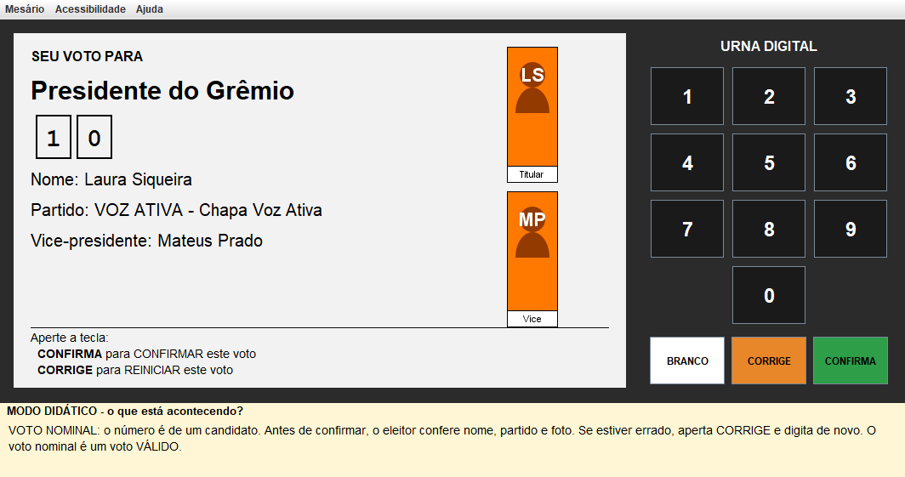
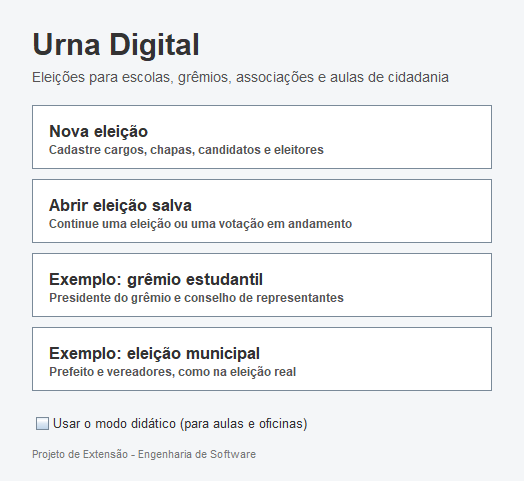
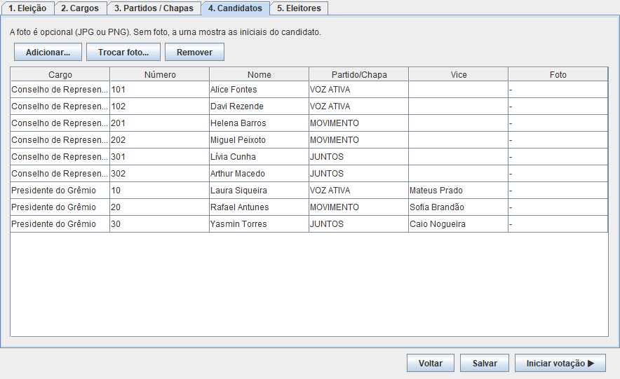
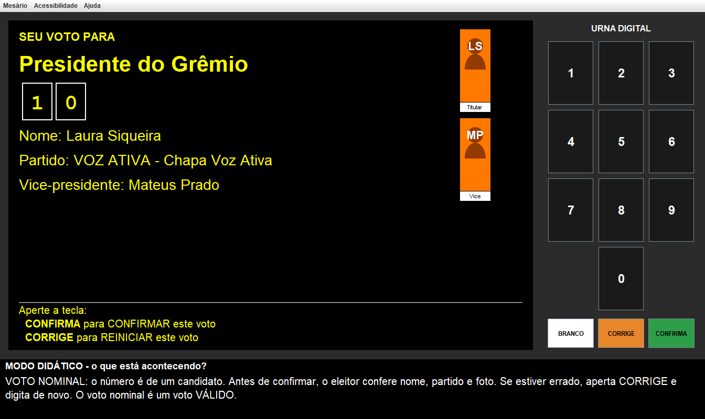

# Urna Digital

[](https://github.com/natanfagundes/urna_digital/actions/workflows/testes.yml)

Simulador da urna eletrônica brasileira para **eleições escolares** (grêmio, representantes de turma,
associações) e para **aulas de educação cidadã**. Feito em Java, sem bibliotecas externas e sem internet.

Projeto de Extensão da disciplina de **Engenharia de Software**.



## Funcionalidades

- **Eleição configurável:** cargos majoritários e proporcionais, com ou sem vice, de 2 a 5 dígitos;
  partidos ou chapas; candidatos com foto; eleitores importados de planilha (CSV/Excel).
- **Urna igual à oficial:** teclado numérico, BRANCO, CORRIGE e CONFIRMA; voto nominal, de legenda,
  branco e nulo; tela "FIM".
- **Mesário:** liberação por título/matrícula (ninguém vota duas vezes), cancelamento por desistência,
  Zerésima, encerramento com senha e Boletim de Urna.
- **Apuração:** maioria simples para cargos majoritários; quociente eleitoral, maior média e votação
  mínima para cargos proporcionais.
- **Nada se perde:** a votação é gravada a cada eleitor e pode ser retomada se o programa fechar ou
  faltar energia. O arquivo é protegido contra alterações (SHA-256).
- **Sigilo:** a urna guarda só os totais, sem ligação com quem votou.
- **Acessibilidade:** alto contraste, fonte grande, leitura em voz alta (em português) e sons das teclas.
- **Modo didático:** explica na tela cada etapa do processo eleitoral, para uso em oficinas.

| Tela inicial | Configuração | Alto contraste e fonte grande |
|---|---|---|
|  |  |  |

## Como executar

Pré-requisito: **Java (JDK) 11 ou superior** — por exemplo, o [Eclipse Temurin](https://adoptium.net/).

- **Windows:** dois cliques em `executar.bat`.
- **Linux / macOS:**

  ```bash
  javac -encoding UTF-8 -d out/main $(find src/main/java -name "*.java") && java -cp out/main urna.Main
  ```

- **Com Maven:** `mvn package` gera `target/urna-digital.jar`, que roda com `java -jar target/urna-digital.jar`.
- **IDE:** abra a pasta no IntelliJ IDEA, Eclipse ou VS Code (o `pom.xml` é reconhecido) e execute `urna.Main`.

### Gerar um .exe para outras pessoas testarem

Dois cliques em **`gerar-exe.bat`** (precisa do JDK 17 ou superior). Ele cria
`dist/UrnaDigital-windows.zip` (~25 MB), que já leva um Java embutido: quem recebe só descompacta e
abre `UrnaDigital\UrnaDigital.exe`, **sem instalar nada**. As eleições ficam na pasta `eleicoes`,
ao lado do programa.

O GitHub Actions também gera essa pasta a cada envio: aba **Actions** → execução mais recente →
**Artifacts** → `UrnaDigital-windows`.

> Como o `.exe` não tem assinatura digital, o Windows pode mostrar "O Windows protegeu o computador".
> Basta clicar em **Mais informações → Executar assim mesmo**.

Para experimentar, escolha um dos exemplos na tela inicial. A senha do mesário é **`1234`**.
No exemplo do grêmio, as matrículas vão de `2026001` a `2026020`.

## Testes

São 47 testes automatizados com **JUnit 5**, cobrindo as regras de votação, a apuração, a gravação e a
importação de eleitores.

```bash
mvn test
```

Os testes também rodam automaticamente no GitHub a cada envio (aba **Actions**), que também gera o `.jar`.

## Documentação

📄 **Versões em PDF:** [Guia Simples](docs/pdf/Urna-Digital-Guia-Simples.pdf) · [Documentação Técnica](docs/pdf/Urna-Digital-Documentacao-Tecnica.pdf)
(para gerar de novo após editar os documentos: `python ferramentas/gerar_pdfs.py`, que usa o Chrome ou o Edge)

**Para quem não é da área de computação**

| Documento | Conteúdo |
|---|---|
| [Guia simples](docs/guia-para-leigos.md) | O que é, como abrir, como votar, tipos de voto, acessibilidade e perguntas frequentes, sem termos técnicos |
| [Manual do usuário](docs/manual-do-usuario.md) | Passo a passo completo para organizar uma eleição na escola |

**Para desenvolvedores e avaliadores**

| Documento | Conteúdo |
|---|---|
| [Documentação técnica](docs/documentacao-tecnica.md) | Build, testes, empacotamento, CI, classes, funcionamento interno, como estender e limitações |
| [Requisitos](docs/requisitos.md) | Requisitos funcionais e não funcionais, regras de negócio e rastreabilidade com os testes |
| [Casos de uso](docs/casos-de-uso.md) | Diagrama e descrição dos casos de uso |
| [Arquitetura](docs/arquitetura.md) | Camadas, diagrama de classes, sequência, estados e formato dos arquivos |
| [Relatório de extensão](docs/relatorio-extensao.md) | Roteiro do relatório, plano de oficina e indicadores |

## Estrutura do projeto

```
src/main/java/urna/
├── Main.java
├── model/          Eleicao, Cargo, Partido, Candidato, Eleitor, Voto
├── service/        Urna, Apuracao, Relatorios, Contagem, EstadoVotacao, Exemplos
├── persistencia/   RepositorioEleicao, ArmazenamentoEmArquivo, ImportadorEleitores, Csv
├── util/           Hash, Textos
└── view/           TelaInicial, TelaConfiguracao, TelaUrna, FotoCandidato, Som, Voz, Didatica
src/test/java/urna/ testes JUnit 5 (mesma estrutura de pacotes)
docs/               documentação de Engenharia de Software
exemplos/           planilha modelo de eleitores
```

## Limitações

A distribuição de vagas proporcionais é uma versão simplificada da lei (ver
[requisitos](docs/requisitos.md#5-limitações-conhecidas-simplificações)). O programa é uma ferramenta
educacional e para eleições de pequeno porte. Ele **não** substitui a urna da Justiça Eleitoral.
