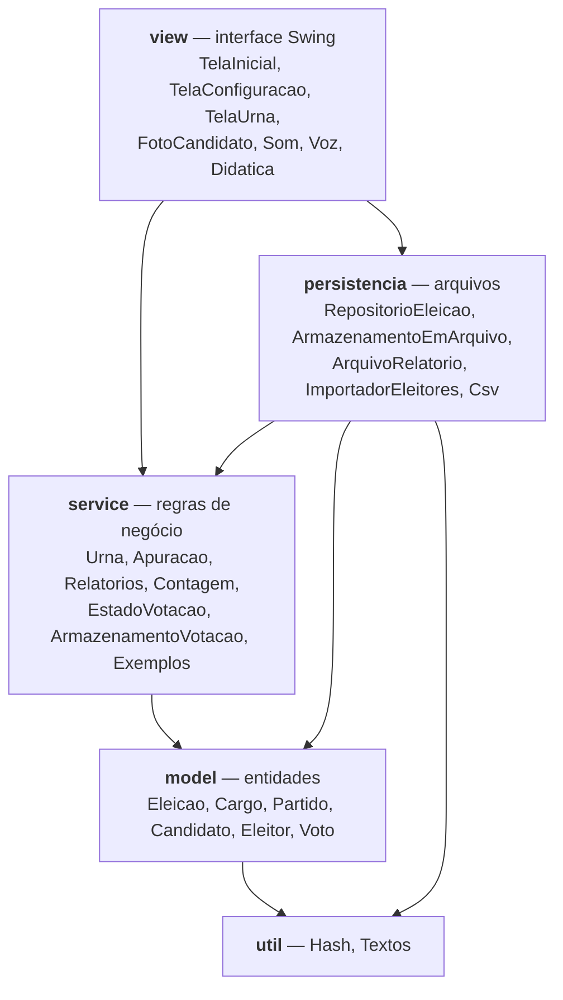
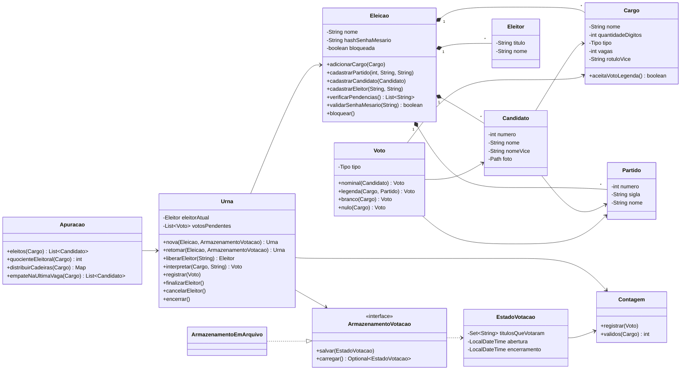
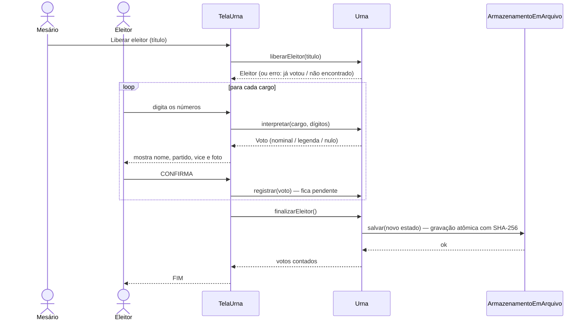
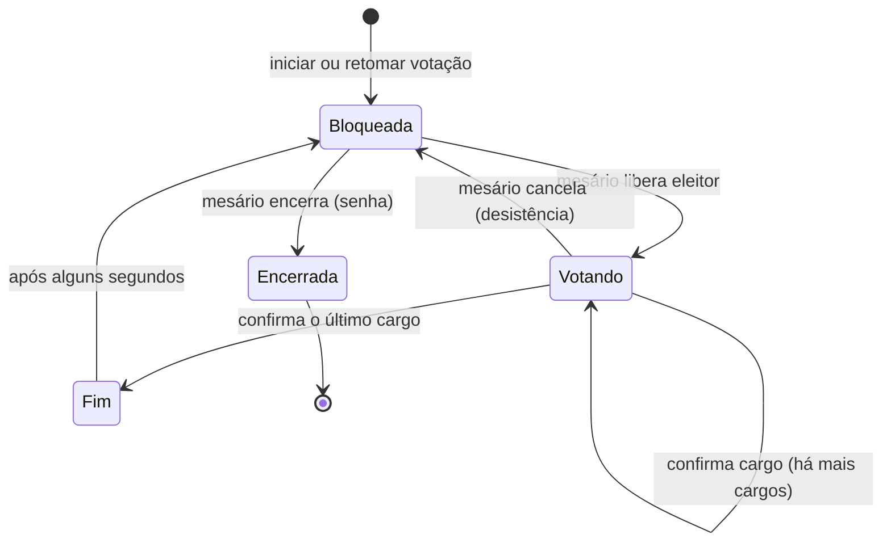

# Arquitetura — Urna Digital

## Camadas

O sistema é dividido em camadas. Cada uma só conhece as camadas abaixo dela, por isso as regras
da eleição podem ser testadas sem abrir nenhuma janela.



`ArmazenamentoVotacao` é uma **interface** da camada de serviço. A `Urna` depende só dela, e a
implementação concreta (`ArmazenamentoEmArquivo`) fica na persistência (inversão de dependência).
Nos testes, a urna recebe um armazenamento em memória.

## Diagrama de classes (domínio e serviço)



## Sequência: um eleitor votando



## Estados da urna (tela)



## Arquivos de uma eleição

```
eleicoes/gremio-estudantil-2026/
├── eleicao.properties     nome e SHA-256 da senha do mesário
├── cargos.csv             ordem;nome;digitos;tipo;vagas;rotulo_vice
├── partidos.csv           numero;sigla;nome
├── candidatos.csv         cargo;numero;nome;partido;vice;foto
├── eleitores.csv          titulo;nome
├── fotos/                 fotos copiadas dos candidatos
├── votacao/estado.txt     votação em andamento (ver abaixo)
└── relatorios/            zeresima_*.txt e boletim_urna_*.txt
```

Os CSV usam `;` e UTF-8 com BOM, então abrem direto no Excel em português.

### `votacao/estado.txt`

```
URNA-DIGITAL-VOTACAO;1
ABERTURA;2026-11-14T08:00:00
VOTOU;2026001            ← em ordem numérica, não na ordem em que votaram
VOTOU;2026007
NOMINAL;Presidente do Grêmio;10;1
BRANCO;Presidente do Grêmio;1
...
SHA256;<resumo de todas as linhas acima>
```

- **Sigilo:** só há totais. Não existe nenhuma ligação entre `VOTOU` e os votos.
- **Atomicidade:** grava em `estado.tmp` e depois renomeia por cima de `estado.txt`.
- **Integridade:** ao carregar, recalcula o SHA-256. Se não conferir, recusa o arquivo.

## Decisões de projeto

| Decisão | Motivo |
|---|---|
| Java + Swing, sem bibliotecas | Roda offline em qualquer computador de escola com Java; nada para instalar além do JDK. |
| Voto como transação (pendente até o FIM) | Uma queda de energia no meio do voto não deixa um eleitor "meio votado". |
| Guardar totais em vez de cada voto | Garante o sigilo por construção, não por cuidado. |
| CSV em vez de banco de dados | O organizador consegue ver, conferir e editar a eleição no Excel. |
| Interface `ArmazenamentoVotacao` | Permite testar a urna sem disco e trocar o armazenamento no futuro. |
| Voz do sistema operacional | Leitura em português sem baixar nada (Windows: System.Speech). |
