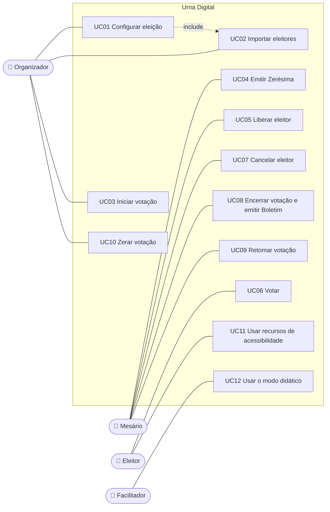

# Casos de Uso — Urna Digital

## Diagrama de casos de uso

## Atores

| Ator | Descrição |
|---|---|
| Organizador | Prepara a eleição: cargos, chapas, candidatos, eleitores e senha. Ex.: professor, comissão eleitoral. |
| Mesário | Opera a urna no dia: libera eleitores, emite a Zerésima e encerra a votação. |
| Eleitor | Vota na urna. Pode usar os recursos de acessibilidade. |
| Facilitador | Conduz oficinas usando o modo didático. |

---

## UC01 — Configurar eleição

- **Ator:** Organizador
- **Pré-condição:** nenhuma.
- **Pós-condição:** eleição salva em `eleicoes/<nome>/`.

**Fluxo principal**
1. O organizador escolhe "Nova eleição" e informa o nome.
2. Cadastra os cargos (nome, tipo, dígitos, vagas e vice) e define a ordem de votação.
3. Cadastra os partidos/chapas.
4. Cadastra os candidatos e, se quiser, escolhe uma foto para cada um.
5. Cadastra ou importa os eleitores (UC02).
6. Define a senha do mesário.
7. Clica em "Salvar". O sistema grava os arquivos e confirma.

**Fluxos alternativos**
- **2a.** Já existe cargo com o mesmo nome: o sistema recusa e explica o motivo.
- **4a.** O número não tem os dígitos do cargo ou não começa com o número do partido: o sistema recusa e mostra a regra.
- **4b.** Cargo com vice e nome do vice vazio: o sistema pede o vice.
- **7a.** Erro ao gravar (disco cheio, sem permissão): o sistema informa e nada é perdido na tela.

## UC02 — Importar eleitores

- **Ator:** Organizador
- **Pré-condição:** planilha CSV com as colunas título/matrícula e nome (o modelo pode ser gerado pelo sistema).

**Fluxo principal**
1. Na aba "Eleitores", o organizador escolhe "Importar planilha CSV".
2. O sistema lê o arquivo (separador `;` ou `,`), ignora o cabeçalho e cadastra os eleitores.
3. O sistema informa quantos foram importados.

**Fluxo alternativo**
- **2a.** Linhas com título repetido, não numérico ou sem nome são recusadas. O sistema lista as linhas e o motivo, e importa as demais.

## UC03 — Iniciar votação

- **Ator:** Organizador
- **Pré-condição:** eleição configurada.
- **Pós-condição:** configuração bloqueada e votação aberta (gravada em disco).

**Fluxo principal**
1. O organizador clica em "Iniciar votação".
2. O sistema verifica as pendências (RF08), salva a eleição e pede confirmação.
3. O sistema bloqueia a configuração, grava o estado inicial e abre a urna, bloqueada à espera do mesário.

**Fluxos alternativos**
- **2a.** Há pendências: o sistema lista o que falta e não inicia.
- **2b.** Já existe votação gravada: o sistema oferece zerá-la (UC10).

## UC05 — Liberar eleitor

- **Ator:** Mesário
- **Pré-condição:** urna bloqueada e votação não encerrada.

**Fluxo principal**
1. O mesário confere o documento do eleitor e escolhe "Liberar eleitor" (Ctrl+L).
2. Digita o título/matrícula.
3. O sistema mostra o nome do eleitor e libera a urna no primeiro cargo.

**Fluxos alternativos**
- **3a.** O título não está na lista: o sistema recusa.
- **3b.** O eleitor já votou: o sistema recusa e mostra o nome.

## UC06 — Votar

- **Ator:** Eleitor
- **Pré-condição:** urna liberada para o eleitor (UC05).
- **Pós-condição:** votos contados, eleitor marcado como "votou" e estado gravado.

**Fluxo principal**
1. O sistema mostra o cargo e as caixas dos dígitos.
2. O eleitor digita o número.
3. Para cargos proporcionais, após 2 dígitos o sistema mostra o partido.
4. Com todos os dígitos, o sistema mostra nome, partido, vice e foto do candidato (voto nominal).
5. O eleitor aperta CONFIRMA.
6. O sistema repete os passos 1 a 5 para cada cargo, na ordem configurada.
7. Após o último cargo, o sistema conta os votos, grava o estado, mostra "FIM" e volta a ficar bloqueado.

**Fluxos alternativos**
- **4a.** Número de partido válido e candidato inexistente (cargo proporcional): o sistema mostra "VOTO DE LEGENDA".
- **4b.** Número inexistente: o sistema mostra "VOTO NULO".
- **2a.** O eleitor aperta BRANCO com o campo vazio: o sistema mostra "VOTO EM BRANCO".
- **2b.** O eleitor aperta BRANCO após digitar: o sistema avisa que o campo deve estar vazio.
- **5a.** O eleitor aperta CORRIGE: o sistema limpa o cargo atual e volta ao passo 1.
- **7a.** Falha ao gravar: os votos do eleitor **não** são contados, o mesário é avisado e pode liberar o eleitor novamente.

## UC07 — Cancelar eleitor

- **Ator:** Mesário
- **Fluxo:** com um eleitor votando, o mesário escolhe "Cancelar eleitor atual" e confirma. Os votos pendentes são descartados e o eleitor poderá votar depois.

## UC08 — Encerrar votação e emitir Boletim

- **Ator:** Mesário
- **Pré-condição:** nenhum eleitor votando.

**Fluxo principal**
1. O mesário escolhe "Encerrar votação" e digita a senha.
2. O sistema pede confirmação, grava o encerramento e exibe o Boletim de Urna.
3. O sistema salva o Boletim em `relatorios/`, com código SHA-256.

**Fluxo alternativo**
- **1a.** Senha incorreta: o sistema recusa e a votação continua.

## UC09 — Retomar votação

- **Ator:** Mesário
- **Fluxo:** ao abrir uma eleição com votação gravada, o sistema oferece "Retomar votação" (ou "Ver resultado", se já foi encerrada). A urna volta com os mesmos totais e a mesma lista de quem votou.
- **Alternativo:** arquivo de votação alterado ou corrompido: o sistema recusa e informa onde está o arquivo.

## UC10 — Zerar votação

- **Ator:** Organizador
- **Fluxo:** com a senha do mesário, a votação atual é movida para `votacao_arquivada_<data>` (nada é apagado) e a configuração volta a poder ser editada.

## UC11 — Usar recursos de acessibilidade

- **Ator:** Eleitor (com apoio do mesário)
- **Fluxo:** pelo menu "Acessibilidade" ou pelas teclas F2 a F4, ativa alto contraste, fonte grande ou leitura em voz alta. Com a voz ativa, o sistema fala o cargo, cada dígito, o candidato e as instruções.

## UC12 — Usar o modo didático

- **Ator:** Facilitador
- **Fluxo:** ativa o modo didático na tela inicial ou com F5. Um painel explica cada etapa: liberação, tipos de voto, sigilo, gravação e boletim.
