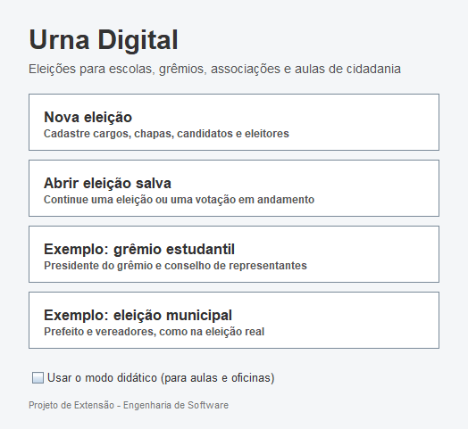
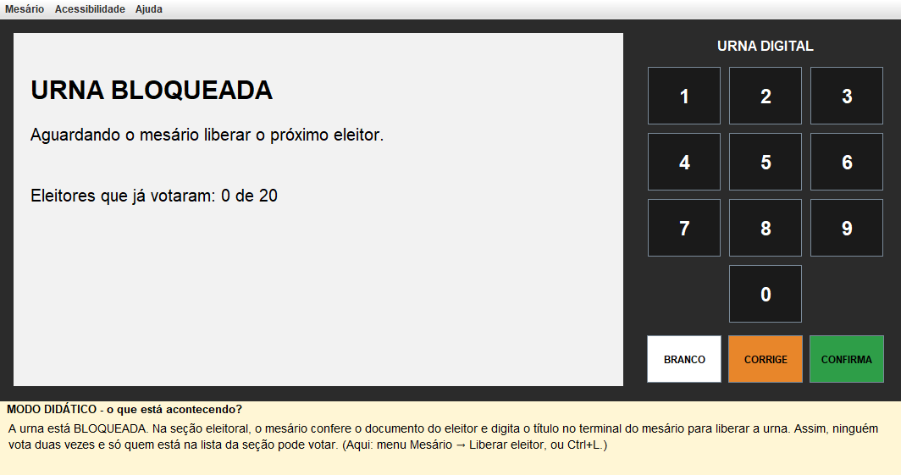
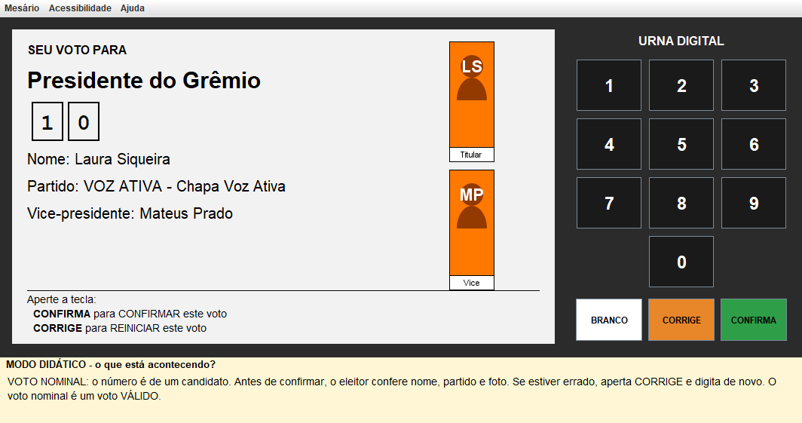
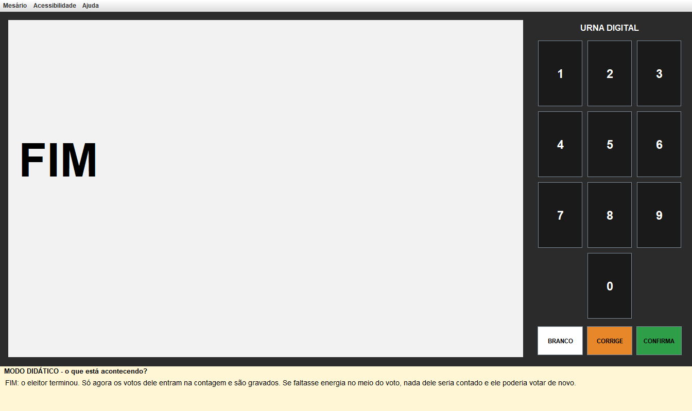
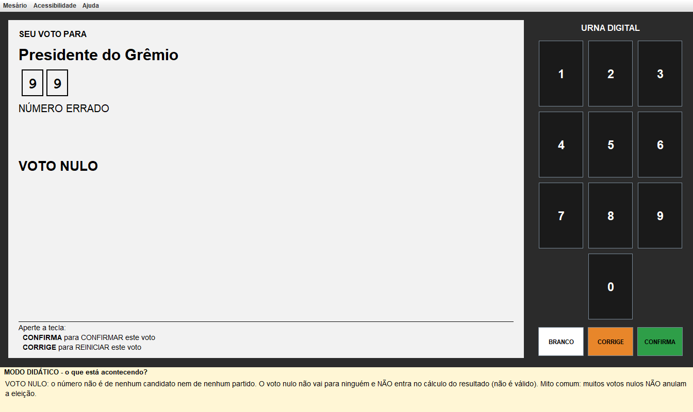
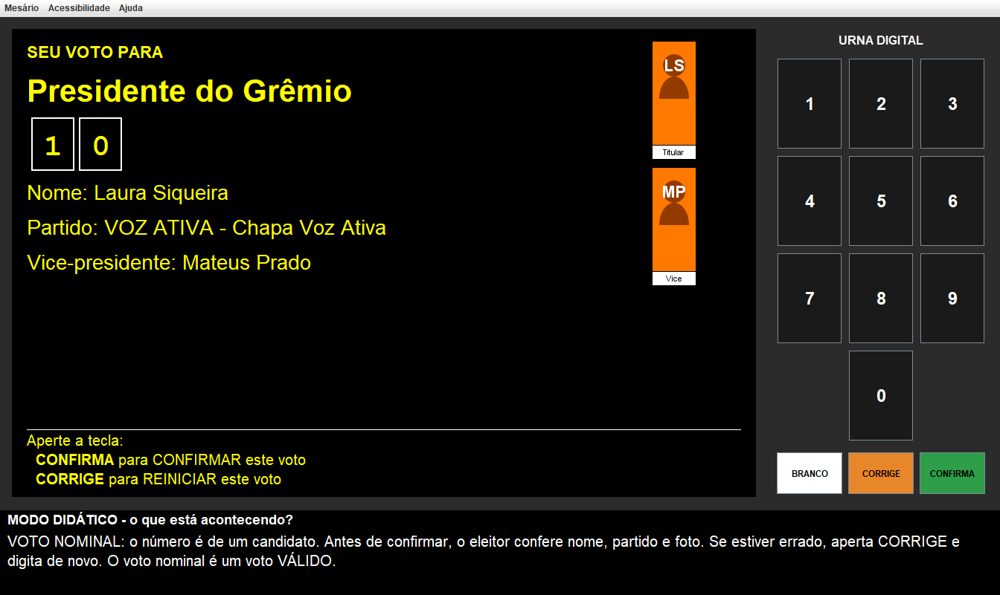
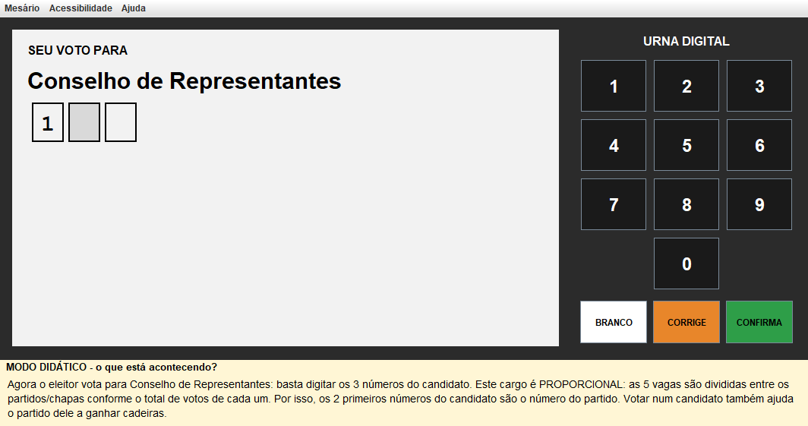

# Urna Digital — Guia Simples

Este guia é para quem **não é da área de computação**: alunos, professores, funcionários da escola,
amigos que vão testar o programa. Não é preciso saber nada de programação.

---

## O que é a Urna Digital?

É um programa de computador que **imita a urna eletrônica** das eleições do Brasil.

Ele serve para duas coisas:

1. **Fazer eleições de verdade** em escolas, grêmios estudantis e associações, sem papel e sem
   precisar contar voto por voto no final.
2. **Ensinar como funciona uma eleição**, em aulas e oficinas: o que é voto branco, voto nulo,
   por que o voto é secreto, como os eleitos são escolhidos.

---

## Como abrir o programa

Você recebeu um arquivo chamado **`UrnaDigital-windows.zip`**.

1. Clique com o botão direito no arquivo e escolha **Extrair tudo...** → **Extrair**.
2. Abra a pasta **UrnaDigital** que apareceu.
3. Dê dois cliques em **UrnaDigital** (o ícone de urna).

Não é preciso instalar nada.

> **Apareceu "O Windows protegeu o computador"?**
> Isso acontece com programas feitos por estudantes, que não têm um "selo" pago da Microsoft.
> Clique em **Mais informações** e depois em **Executar assim mesmo**.

---

## Primeira vez: testando com um exemplo

1. Na primeira tela, clique em **Exemplo: grêmio estudantil**.
2. Na tela seguinte, clique no botão **Iniciar votação ▶** (canto de baixo, à direita) e confirme.
3. A urna aparece **bloqueada**, esperando o mesário:

4. Faça o papel de **mesário**: aperte as teclas **Ctrl + L** (ou vá no menu **Mesário → Liberar eleitor**)
   e digite a matrícula **`2026001`**.
5. Agora faça o papel de **eleitor** e vote (veja a próxima seção).
6. Para votar de novo, libere outra matrícula: **`2026002`**, **`2026003`**... até **`2026020`**.

**Senha do mesário no exemplo:** `1234`

---

## Como votar

Votar aqui é igual a votar na urna de verdade.

### 1. Veja para qual cargo você está votando

O nome do cargo aparece em letras grandes, por exemplo **Presidente do Grêmio**.

### 2. Digite o número do candidato

Use os números da tela (clicando) ou do teclado do computador.
A foto, o nome e a chapa do candidato aparecem:

### 3. Confira e aperte a tecla verde

| Tecla | Cor | Para que serve |
|---|---|---|
| **CONFIRMA** | 🟩 verde | Confirma o voto. No teclado do computador: **Enter** |
| **CORRIGE** | 🟧 laranja | Apaga o que você digitou para começar de novo. No teclado: **Backspace** (a tecla de apagar) |
| **BRANCO** | ⬜ branca | Vota em branco (em ninguém). No teclado: **B** |

### 4. Repita para o próximo cargo

Quando todos os cargos forem votados, aparece **FIM**. Pronto, seu voto foi registrado!

---

## Os tipos de voto, explicados de um jeito simples

| Tipo | Quando acontece | O voto vai para alguém? |
|---|---|---|
| **Voto em candidato** | Você digita o número de um candidato que existe | ✅ Sim, para o candidato (e ajuda a chapa dele) |
| **Voto na chapa (legenda)** | Você digita um número que não é de nenhum candidato, mas começa com o número de uma chapa | ✅ Sim, para a chapa |
| **Voto em branco** | Você aperta BRANCO sem digitar nada | ❌ Não vai para ninguém |
| **Voto nulo** | Você digita um número que não existe | ❌ Não vai para ninguém |

> **Mito:** "Se a maioria votar nulo, a eleição é anulada."
> **Verdade:** isso **não** acontece. Votos brancos e nulos simplesmente não contam para ninguém.

---

## Seu voto é secreto?

**Sim.** A urna só guarda **quantos votos** cada candidato recebeu. Ela anota **quem** já votou
(para ninguém votar duas vezes), mas guarda isso **separado**, sem nenhuma ligação com o voto.
Nem quem fez o programa consegue descobrir em quem você votou.

---

## Para quem enxerga pouco ou não enxerga

O programa tem recursos de acessibilidade, no menu **Acessibilidade** ou pelas teclas de cima do teclado:

| Tecla | O que faz |
|---|---|
| **F2** | **Alto contraste:** fundo preto e letras amarelas, mais fácil de ler |
| **F3** | **Letras grandes** |
| **F4** | **Leitura em voz alta:** o computador fala o cargo, os números digitados, o nome do candidato e as instruções |

Com a voz ligada, uma pessoa cega consegue votar sozinha usando o teclado do computador:
números, **Enter** para confirmar e **Backspace** para corrigir.

---

## Para professores: o modo aula

Na primeira tela, marque **Usar o modo didático**, ou aperte **F5** durante a votação.
Uma faixa amarela aparece embaixo da urna explicando, passo a passo, o que está acontecendo e por quê:

É ótimo para projetar na sala e fazer uma votação com a turma.

---

## Organizando uma eleição de verdade (resumo)

> O passo a passo completo está no [Manual do Usuário](manual-do-usuario.md).

**Antes da eleição**
1. Clique em **Nova eleição** e dê um nome.
2. Cadastre os **cargos** (ex.: Presidente), as **chapas** e os **candidatos** (pode colocar foto).
3. Cadastre os **eleitores**. Dá para trazer a lista de alunos de uma planilha do Excel.
4. Crie uma **senha do mesário** e guarde bem: ela é necessária para encerrar a votação.

**No dia**
1. Clique em **Iniciar votação**.
2. Menu **Mesário → Emitir Zerésima**: é um papel que mostra que todos os candidatos começam com
   **zero** votos. Serve para provar que ninguém "já colocou votos" antes.
3. Para cada eleitor: confira o documento, libere a urna (**Ctrl + L**) e deixe ele votar sozinho.

**No final**
1. Menu **Mesário → Encerrar votação** e digite a senha.
2. Aparece o **Boletim de Urna**, com o resultado e os eleitos. Ele também fica salvo num arquivo
   para imprimir ou mostrar a todos.

---

## Perguntas frequentes

**A luz acabou / o computador desligou no meio da votação. Perdi tudo?**
Não. Os votos ficam salvos a cada pessoa que termina de votar. Abra o programa, clique em
**Abrir eleição salva**, escolha a eleição e clique em **Retomar votação**. Só quem estava votando
naquele momento precisa votar de novo.

**Um aluno começou a votar e desistiu. E agora?**
Menu **Mesário → Cancelar eleitor atual**. Nada do que ele digitou é contado, e ele pode votar depois.

**Alguém pode votar duas vezes?**
Não. A urna recusa uma matrícula que já votou.

**Esqueci a senha do mesário.**
A senha não pode ser descoberta, só trocada antes de a votação começar. Veja o
[Manual do Usuário](manual-do-usuario.md#8-problemas-comuns).

**Precisa de internet?**
Não. O programa funciona totalmente sem internet.

**Funciona em Mac ou Linux?**
Funciona, mas o arquivo `.zip` pronto é só para Windows. Em outros sistemas é preciso instalar o
Java e abrir pelo código (veja a [Documentação Técnica](documentacao-tecnica.md)).

---

## Pequeno dicionário

| Palavra | Significado |
|---|---|
| **Mesário** | Pessoa que cuida da urna: confere quem vai votar e libera a urna |
| **Chapa / partido** | Grupo de candidatos. Cada um tem um número de 2 algarismos |
| **Cargo majoritário** | Ganha quem tiver mais votos (ex.: presidente, prefeito) |
| **Cargo proporcional** | As vagas são divididas entre as chapas de acordo com os votos de cada uma (ex.: conselho, vereadores) |
| **Voto de legenda** | Voto na chapa, sem escolher um candidato específico |
| **Votos válidos** | Votos em candidatos e em chapas. Brancos e nulos não são válidos |
| **Zerésima** | Relatório do início, que mostra todos com zero votos |
| **Boletim de Urna** | Relatório do final, com o resultado |
| **Quociente eleitoral** | Quantos votos uma chapa precisa para ganhar uma vaga (votos válidos ÷ número de vagas) |
| **Abstenção** | Pessoa que podia votar, mas não votou |
